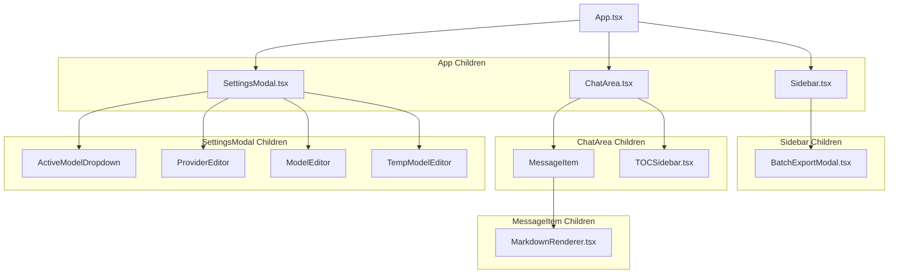

# 组件结构文档

## 组件树

## `App.tsx` — 状态管理中心

**职责**:

*   **状态中心**: 作为整个应用的顶层组件，管理所有核心状态，包括 `sessions`、`currentSessionId`、`unsavedSessionIds`、`settings`、`templates`、`isSettingsOpen`、per-session `generatingSessions` 与 `stoppingSessions`。
*   **数据获取**: 启动时并行拉取 `sessions`、`settings`、`templates` 与正在运行的生成任务列表（`getRunningSessions`）。
*   **未保存会话管理**: 使用 `unsavedSessionIds` Set 跟踪本地尚未发送消息的新建会话，`handleNewChat` 复用既有未保存会话；`handleDeleteChat` 会停止生成流（`api.chat.stop(id)`），对已落盘会话调用 `api.sessions.delete(id)`，并清理本地草稿与加星记录。
*   **设置持久化与生成同步**: 共享状态变更通过 `updateGlobalSettings` 串行进入 `settingsSaveQueue`；在发起任何生成操作（`handleSendMessage`、`handleRetry`、`handleContinue`、`handleRegenerate`）前调用 `awaitSettledSettingsSave()`，确保最新设置已完整写入磁盘再由后端解析。
*   **角色过继同步**: `handleSaveSettings` 在保存设置后重新拉取服务端会话列表，同时保留本地未保存会话并根据 `characterReassignments`（或回退到 `activeCharacterId`）更新其 `characterId`。
*   **关闭拦截**: 注册全局 `window` `beforeunload` 监听器，在关闭标签页或刷新浏览器前提示确认。
*   **左侧栏宽度记忆**: 桌面端拖拽调整左侧栏宽度（`180px`–`480px`，默认 `256px`）后，自动记忆至 `localStorage`（`chat_sidebar_width`）。

## `Sidebar.tsx` — 左侧栏

**职责**:

*   **会话列表与分组**: 按更新时间倒序展示并按日期分组（今天 / 昨天 / 近7天日期 / 最近一个月 / 过去一年 / 更早）。
*   **分类过滤**: 在会话列表上方提供角色选择器，允许用户按 `session.characterId` 过滤会话。
*   **常规与全文搜索**:
    *   默认实时按标题或会话 ID 过滤（忽略空白与大小写）。
    *   点击输入框内的全文搜索按钮（或非空输入回车）进入全文搜索模式，调用 `normalizeForSearch`（忽略大小写、所有空白及 `<think>` 块）异步分批检索所有会话正文，显示进度条并锁定输入；通过 `activeSearchIdRef` 使过期的异步扫描失效，关闭/退出全文搜索时弹出确认弹窗。
*   **批量导出模式**: 切换批量选择模式后可多选会话并打开 `BatchExportModal.tsx` 导出压缩包。
*   **加星功能 (Starring)**: 支持黄、红、蓝、绿、橙五种预设颜色（`settings.starredSessions`），有加星会话时在顶部展示可折叠的「已加星会话」分组。
*   **用户交互**: 切换、新建、复制、删除、加星会话，以及打开设置模态框。

## `BatchExportModal.tsx` — 批量导出弹窗

**职责**:

*   **多选打包导出**: 接收 `selectedSessionIds`，逐一通过 `api.sessions.get(id)`（失败回退内存列表）拉取完整会话并使用 `JSZip` 打包为 `batch_export_YYYYMMDD_HHMMSS.zip`。
*   **格式与思考开关**: 支持 Markdown（`.md`，含 `# 标题` 与 `### User/AI`）和纯文本（`.txt`，无 `#`/`###` 标题符号，使用 `[User]`/`[AI]`），并支持选择保留或通过 `stripThinking` 移除 `<think>` 块。
*   **完整性校验**: 收集拉取失败的会话 ID，若存在失败项则中止打包并提示错误，避免生成不完整的导出包。

## `ChatArea.tsx` — 聊天主区域

**职责**:

*   **消息显示与续写平滑更新**: 渲染会话消息列表，订阅 SSE (`delta`、`done`、`error`、`stopped`)。当处于生成中且末尾已存在 `model` 消息（Continue / Regenerate 场景）时，直接原地更新最后一条消息内容，避免重复块或布局跳动。
*   **草稿持久化**: 将未发送的输入内容以 500ms 防抖保存至 `localStorage` 的 `chat_drafts`（7 天过期）；New Chat 与未保存会话使用专用键 `NEW_CHAT_DRAFT_KEY = '__new_chat_draft__'`。在组件卸载/会话切换时立即 flush，在发送消息或删除会话时清除。
*   **输入与放大编辑弹窗**:
    *   主输入框支持 `Ctrl+Enter` 发送、`Enter`/`Shift+Enter` 换行，并显示估算 Token 与字符数。默认与最小高度均为 `44px`（单行高度），不随输入内容自动伸缩；鼠标指向输入框顶部边缘即可上下拖动调整高度（上限 `60vh`），松手后自动记忆至 `localStorage`（`chat_input_height`）。
    *   点击 `Maximize2` 按钮打开左右分栏放大编辑弹窗（左侧代码/Markdown `textarea`，右侧经 `useDeferredValue` 延迟优化的 `MarkdownRenderer` 实时预览）。文本框内按 `Tab` 插入两个空格（优先使用 `document.execCommand('insertText')` 并提供手动选区回退）；弹窗内其它可聚焦元素使用 `Tab` 焦点陷阱，`Esc` 或 `Minimize2` 关闭后焦点恢复至打开按钮；弹窗内禁止直接发送消息以防长内容误发。
*   **会话级编辑与角色标记**:
    *   顶栏展示并允许修改当前会话的 `characterId`（通过 `onUpdateSessionCharacter` 更新会话本身，与全局 `settings.activeCharacterId` 完全解耦）。
    *   支持打开分块编辑弹窗（`parseMessagesToBlocks` / `compileBlocksToMessages`），将消息拆分为可上/下移动、修改类型、删除、新增的 `input` / `thinking` / `output` 块（文本框 `rows={6}`、`min-h-[160px]`），保存时调用 `PATCH /api/sessions/:id`。
*   **快捷选择栏与 System Prompt 预览**:
    *   **Model 下拉框**: 跨提供商子串模糊搜索（`normalizeSearchString` 忽略空格、换行、横杠、中英文逗号、句点、下划线与大小写），左侧显示 `displayName`、右侧 CSS 截断显示 `modelId` 并带原生 `title={modelId}` 提示；打开或关闭时清空搜索词，支持 `Escape` 关闭与 `Enter` 选中首个匹配项并把焦点归还至 `modelToggleBtnRef`，打开时将当前活跃模型滚入可视区域（`scrollIntoView({ block: 'nearest' })`）。
    *   **Character 下拉框**: 切换全局 `activeCharacterId`。
    *   **System Prompt 预览弹窗**: 点击 toolbar 的 `System Prompt` 按钮以无障碍弹窗（`role="dialog"`、`aria-modal="true"`）展示 `buildConstructedSystemPrompt` 生成的完整提示词并支持复制。
    *   **Skills 下拉框**: 绑定 `settings.activeSkillIds` 的多选菜单，使用响应式宽度（`w-80 sm:w-[26rem] min-w-[300px] max-w-[90vw]`）和自适应对齐（`left-0 sm:left-auto sm:right-0`）完整展示长技能名。
    *   **Templates 下拉框**: 拉取并追加 `/api/templates` 的模板内容至输入框并聚焦输入框。
*   **目录侧栏集成**: 集成 `TOCSidebar.tsx`，支持桌面端鼠标拖拽调宽（`200px`–`600px`，默认 `288px`，自动记忆至 `localStorage` 的 `chat_toc_width`）、默认展开到 `H6`、监听 `#chat-scroll-container` 滚动计算当前活跃标题，并将桌面端目录显隐状态自动记忆至 `localStorage`（`chat_toc_open`）。
*   **纯净 PDF 打印 (`executePrint`)**:
    *   支持单条预览打印（自动前置 `<h1>Session ID: [id]</h1>`）与顶栏全会话打印（通过 `isPrintingAll` 惰性渲染 `#print-all-session-content` 以避免流式阶段额外开销）。
    *   统一在隐藏 `iframe` 中注入全局打印样式（无 `@media print` 嵌套）：强制浅色模式（`color-scheme: light !important`）、`.katex { font-size: 0.9em; }`、`.katex .frac-line` 强制黑框黑字，确保打印对比度。

### `MessageItem` (子组件)

*   **职责**: 渲染单条消息、折叠/展开 `<think>` 思考过程，以及悬停操作按钮（View、Copy、Retry、Regenerate、Continue）。
*   **Copy（复制）**: 同时写入纯文本与富文本 HTML（`ClipboardItem`），不包含 `<think>` 思考过程。
*   **View（查看）**: 点击 👁️ 按钮弹出全屏预览层（模型消息会附带最近一条用户问题），锁定底层滚动并支持 `Ctrl+P` 打印或 `Esc` 关闭。
*   **Retry / Regenerate / Continue**: 分别触发对应生成操作（均通过后端 `GenerationManager` 原地处理）。

## `TOCSidebar.tsx` — 目录导航侧栏

**职责**:

*   **AST 标题提取**: 调用 `src/lib/toc.ts`（`unified` + `remark-parse` + `remark-gfm` + `remark-math`）解析每条消息的 Markdown 标题，递归提取纯文本并剔除 `<think>` 块及非正文元素。
*   **层级筛选与折叠**: 支持 `H1`–`H6` 层级过滤（默认 `H6`）、全部展开/折叠、按消息卡片分组展示（附带角色标签与正文摘要）。
*   **联动定位**: 随 `#chat-scroll-container` 滚动自动展开当前活跃消息卡片、折叠非活跃卡片，并将当前活跃标题项自动滚入 TOC 可视区域；窄屏（`<768px`）下切换为滑出抽屉遮罩层。

## `MarkdownRenderer.tsx` — Markdown 渲染器

**职责**:

*   **Markdown-to-HTML**: 使用 `react-markdown` 将 Markdown 文本安全地转换为 React 组件。
*   **插件管线**: 集成 `remark-gfm`、`remark-math`、`remark-breaks`、`remark-squeeze-paragraphs`、`remark-cjk-friendly` 及 `rehype-raw`、`rehype-sanitize`、`rehype-katex`、`rehype-external-links`。
*   **数学渲染**: 将 `\[...\]` / `\(...\)` 规范化为 `$$...$$` / `$...$`，统一使用 `rehype-katex` 配合 `src/lib/mathEngine.ts` 的 `SHARED_KATEX_OPTIONS` 进行同步渲染。
*   **TOC 锚点插件**: 通过自定义 `rehypeTocHeadingIds` 插件在 rehype AST 阶段按文档顺序为标题注入确定性锚点 ID（`toc-msg-${messageId}-h-${index}`）。

## `SettingsModal.tsx` — 设置弹窗

**职责**: 提供一个集中界面管理所有配置，并在存在未保存子表单编辑（Provider、Model、TempModel、Character、Skill、Template 或便利贴）时通过确认弹窗拦截关闭或主保存操作（`hasUnsavedEdits`）。

### General Tab

*   **活跃模型选择 (`ActiveModelDropdown`)**: 从常规模型（按 Provider 分组）及临时模型中选择当前活跃模型。
*   **活跃角色预览**: 显示当前激活的角色名称及其系统提示词摘要。
*   **选项开关**: 控制 `autoScroll`、`collapseThinkingFinished`、`renderThinkingAsMarkdown`、`trimThinkingSpaces`（仅影响前端展示的思考前导空格清理）、`stripThinkingForApi`（向 API 隐藏历史思考块）以及 `userAsSystem`（以 `role: 'user'` + `<system>` 包装发送系统提示词）。
*   **全局便利贴 (`stickyNotes`)**: 采用拟真胶带纸张卡片样式的便签面板，支持新增、编辑与删除，持久化至 `settings.json`。
*   **危险区域操作**:
    *   **导出为 ChatGPT 格式**: 通过分片时间弹窗（`chatgptChunks`）过滤目标更新时间之后的会话并支持编辑各时间点备注（`chatgptChunkRemarks`）；调用 `shared/chatgpt-export.ts` 生成 `All_Conversations.zip` 及各非空角色子压缩包（每个均含 `conversations.json`、`user.json`、`export_manifest.json`），导出成功后自动追加当前时间分片。
    *   **强制清洗数据**: 调用 `/api/sessions/clean` 规范化所有会话数据。

### Providers Tab

*   **供应商管理**: 通过 `ProviderEditor` 添加、编辑、删除 `ProviderInstance`（配置类型、Base URL、API Key、Env Key、Extra Config JSON 及模型同步模式 `modelSyncType`: `none` / `json` / `v1_models`）。

### Models Tab

*   **临时模型 (Temp Models)**: 置顶区域管理独立于 Provider 的临时模型（`TempModelEditor`，强制限制 `temperature` 范围为 `0`–`2`、`maxTokens` 范围为 `1`–`1000000`）。
*   **常规模型**: 手动配置模型按 Provider 直接展示；通过 `json` 或 `/v1/models` 同步的模型分别放入默认折叠的手风琴面板中。
*   **底部吸底栏**: `Add Temp Model` 与 `Add Model` 按钮固定吸底停靠并预留底部留白，避免遮挡长列表末尾项。

### Characters Tab

*   **角色管理**: 添加、编辑、删除 `Character`。删除角色时弹出过继确认框，要求选择剩余角色（或置空）接管其关联会话并维护链式重映射（`characterReassignments`），主保存时通过 `api.sessions.update` 逐会话更新（带容错统计）。

### Skills Tab

*   **技能管理**: 添加、编辑、删除独立于角色的技能提示词 (`Skill`)，默认包含 `"Assistant"` 技能。

### Templates Tab

*   **模板管理**: 添加、编辑、删除聊天自动填入模板；列表按名称自动排序（`sortTemplates`），保存后通过 `/api/templates` 持久化到 `data/templates.json`。
